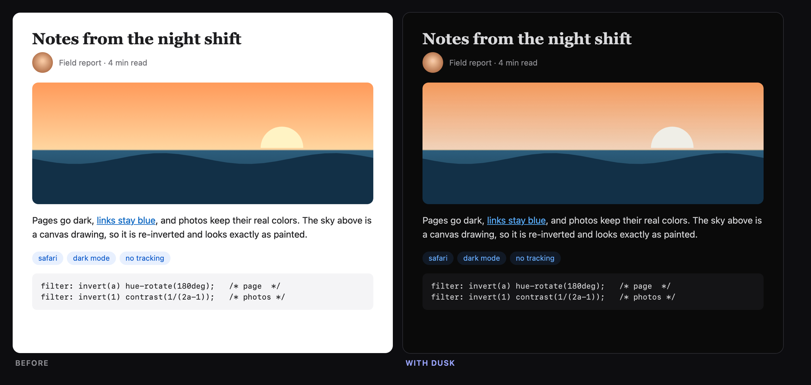
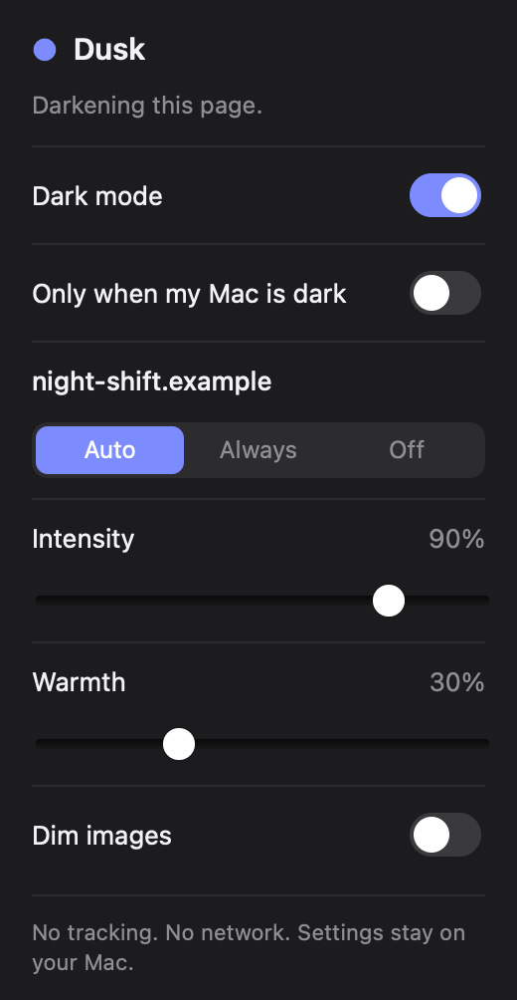

<div align="center">

# ☾ Dusk

**A dark mode for Safari that knows the difference between a page and a photograph.**




</div>

---

## The short version

I wanted a dark mode for Safari that does not crash, track or phone home. The free ones I tried kept crashing Safari when I switched apps. So I wrote one that does almost nothing at runtime: the browser's own rendering engine does the work, and Dusk only tells it what to skip.

## Spec sheet

| | |
|---|---|
| **Engine** | One CSS filter on `<html>`. No DOM rewriting, no per-element colour maths. |
| **Photos** | Re-inverted with an exact inverse, so they keep their real colours at every intensity. |
| **Already-dark sites** | Detected and left alone (15 on-screen samples including the page margins, two thirds must agree), and remembered, so the next visit never flashes inverted. |
| **Speed** | Page load within about 10 ms of no extension. Dusk off for a site costs about 1 ms. |
| **Privacy** | No network, no background script, no page content read. Stores only your settings and which sites are already dark, on your Mac. Two permissions: `storage`, `activeTab`. |
| **Size** | About 1,100 lines including the popup, most of it comments. |

## The toolbar menu



Click the Dusk button in Safari's toolbar. Every change applies to open tabs at once.

- **Status:** what Dusk is doing on this page, and why.
- **Dark mode:** the main switch.
- **Only when my Mac is dark:** follows macOS appearance, live.
- **This site:** *Auto* darkens unless the site is already dark. *Always* and *Off* override it.
- **Intensity:** soft gray to near black.
- **Warmth:** a sepia tint for late reading.
- **Dim images:** photos at 80% so they do not glare.

No button? **View › Customize Toolbar** and drag Dusk in.

<br clear="right">

## How it works

The page is inverted with one filter, and every picture is flipped back:

```css
html  { filter: invert(a) hue-rotate(180deg); }               /* the page  */
img   { filter: invert(1) contrast(1 / (2a − 1)) hue-rotate(180deg); }  /* photos */
```

`invert(a)` maps a colour *x* to *a + (1 − 2a)·x*. A plain `invert(1)` on photos only cancels that when *a* is exactly 1, so most dark-mode filters leave photos washed out. `invert(1)` followed by `contrast(1 / (2a − 1))` is the exact inverse at any intensity, so grays, skin tones, black and white come back unchanged.

CSS cannot see everything that is a picture, so a small scanner fills the gaps. It runs in 5 ms slices right after a frame is painted, so it never competes with the page:

| Mark | What it catches |
|---|---|
| `data-dusk-bg` | Photo backgrounds set from a stylesheet, including lazy-loaded avatars that get their photo later. |
| `data-dusk-keep` | Blocks that were already black on the page, so they do not turn into white slabs. |
| `data-dusk-scrim` | Translucent overlays behind modals, so they dim instead of turning into a milky veil. |
| `data-dusk-pb/pa` | Photos drawn by `::before` and `::after`. |

Open shadow DOM gets the same rules through one shared constructed stylesheet. SVG logos and icons are left inverted with the text, because they are usually one dark colour and would vanish otherwise.

## Numbers

Measured in WebKit, Safari's engine, median of 5 runs. The heavy page has 30,000 elements and 2,400 background images.

| | No Dusk | Dusk 1.3 | **Dusk 1.4** |
|---|---|---|---|
| Heavy page: `DOMContentLoaded` | 25 ms | 185 ms | **30 ms** |
| Heavy page: Dusk's own main-thread time | – | 144 ms | **48 ms** |
| Page under 1,000 mutations a second: Dusk's time | – | 195 ms | **74 ms** |
| Slowest single slice | – | 128 ms | **6 ms** |
| Scrolling 200 photos: slowest 5% of frames | 17 ms | 41 ms | **17 ms** |
| Scrolling 200 photos: CPU | 1× | 3.4× | **1.2×** |
| Dusk off for the site | – | 8 ms | **≤ 1 ms** |

The test suite runs Dusk in real WebKit:

- 243 tests, run 3× in CI-style passes with no flakes
- about 4,700 generated cases (every CSS colour syntax checked against a canvas, random settings, random DOM trees up to 5,000 wide or 2,000 deep)
- pixel checks on 44 tricky layouts: shadow DOM, lazy avatars, SVG photos, fullscreen video, modal dialogs
- hostile pages that fight back: removing Dusk's attribute in a loop, replacing `<html>`, strict CSP, 100,000 elements, broken storage
- a visual pass over 35 real sites, comparing screenshots with and without Dusk

```bash
cd tests && npm install && npx playwright install webkit
npx playwright test        # the suite
npm run perf               # the benchmark above
npm run visual             # real-site screenshots, before and after
```

## Install

Safari loads extensions only from inside a Mac app, so you build a tiny wrapper once. You need Xcode (free) and an Apple ID.

```bash
git clone https://github.com/flawnull/dusk && cd dusk
./build-mac.sh --teams                 # shows your team ID
TEAM=ABCDE12345 ./build-mac.sh         # builds, signs, registers with Safari
```

Then **Safari › Settings › Extensions**, tick **Dusk**, and allow it on all websites. Rebuilding later updates Dusk in place: no app window, nothing to click. Free Apple ID signing lasts about 7 days, so run the build again to renew.

Without `TEAM`, the script opens the project in Xcode instead: pick your team under *Signing & Capabilities* and press ⌘R.

**No Xcode?** Point **Safari › Settings › Advanced › Style sheet** at [`stylesheet-fallback/dusk.css`](stylesheet-fallback/dusk.css). It has no menu and no dark-site detection, but it cannot break anything either.

## Known limits

Each of these has a test that documents it.

- **Very saturated colours come back duller.** Pure red returns as about (172, 63, 63). Any filter that keeps page hues right has this limit.
- **The first visit to a dark web app** can show it inverted briefly: Dusk checks again 0.3, 0.8 and 1.6 s after the page appears. Later visits start dark.
- **Emoji are text**, so they are inverted with the page.
- **Photo backgrounds that fill the window, repeat, or sit fixed behind the page stay inverted**, so the page text on top of them stays readable. Hero banners and photos in `` keep their real colours.
- **Closed shadow roots** cannot be reached by any extension. Frames are not darkened from inside.
- **List-bullet images and `border-image`** are not re-inverted.
- **Sites can tell Dusk is on**, from the `data-dusk` attribute and the filter on `<html>`.

## Layout

```
extension/
  content.js            switches the filter, scans for pictures, detects dark sites
  dusk.css              the filter rules (Safari injects it, so page CSP cannot block it)
  popup/                the toolbar menu
build-mac.sh            wraps the extension in a macOS app and registers it
stylesheet-fallback/    one CSS file for Safari's built-in style sheet option
tests/                  WebKit suite, benchmark, visual QA (Playwright)
```

## License

MIT
